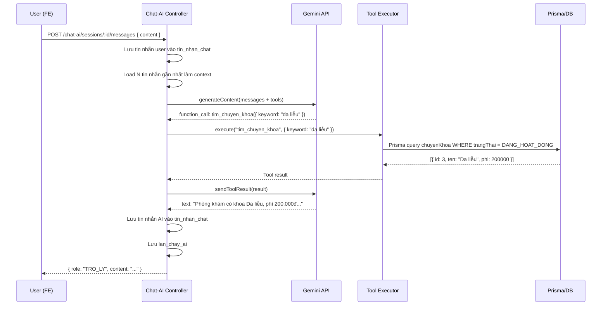

# CHATBOX.md — Kế hoạch Chatbox AI Gemini + AI Cảnh báo

**Ngày tạo:** 09/08/2026  
**Phạm vi:** Chatbox AI dùng Gemini API, AI cảnh báo đơn thuốc  
**Nguyên tắc:** Chưa code, chỉ phân tích và lập kế hoạch. Chờ duyệt.

---

## 1. KIỂM TRA DATABASE — BẢNG ĐÃ CÓ VÀ TRẠNG THÁI SỬ DỤNG

> **Mục đích:** Đối chiếu schema.prisma với source code thật để xác định bảng nào đang được sử dụng, bảng nào đã có nhưng chưa ai gọi, và có cần bổ sung gì không.

| # | Bảng | Đã có | Module BE đang dùng | Module FE đang dùng | Đủ cho Chatbox? | Đủ cho AI cảnh báo? | Cần bổ sung? |
|---|------|-------|---------------------|---------------------|-----------------|---------------------|-------------|
| 1 | `phien_chat` | ✅ Schema có | ❌ Chưa có module BE | ❌ Chưa có FE | ✅ Đủ cấu trúc | — | Tạo module BE + FE |
| 2 | `tin_nhan_chat` | ✅ Schema có | ❌ Chưa có module BE | ❌ Chưa có FE | ✅ Đủ cấu trúc | — | Tạo module BE + FE |
| 3 | `lan_chay_ai` | ✅ Schema có | ❌ Chưa có module BE | ❌ Chưa có FE | ✅ Đủ cấu trúc | ✅ | Tạo module BE |
| 4 | `lich_hen` | ✅ Schema + code | `lich-hen` module | `lich-hen` module | ✅ Có `NguonDatLich.AI_HO_TRO` | — | Không — tái sử dụng |
| 5 | `benh_nhan` | ✅ Schema + code | `benh-nhan`, `tiep-don`, `kham-benh`, `lich-hen` | `benh-nhan`, `lich-hen` | ✅ | ✅ | Không |
| 6 | `nguoi_dung` | ✅ Schema + code | `nguoi-dung`, `xac-thuc` | `nguoi-dung`, `xac-thuc` | ✅ | — | Không |
| 7 | `bac_si` | ✅ Schema + code | `bac-si` | `bac-si` | ✅ | — | Không |
| 8 | `chuyen_khoa` | ✅ Schema + code | `chuyen-khoa` | `chuyen-khoa` | ✅ | — | Không |
| 9 | `dich_vu` | ✅ Schema + code | `dich-vu` | `dich-vu` | ✅ | — | Không |
| 10 | `ho_so_kham` | ✅ Schema + code | `kham-benh` | `kham-benh` | ✅ Tra cứu cho BN đã đăng nhập | ✅ | Không |
| 11 | `don_thuoc` | ✅ Schema + code | `kham-benh`, `cap-thuoc` | `cap-thuoc`, `kham-benh` | — | ✅ | Không |
| 12 | `chi_tiet_don_thuoc` | ✅ Schema + code | `kham-benh`, `cap-thuoc` | `cap-thuoc` | — | ✅ | Không |
| 13 | `thuoc` | ✅ Schema + code | `thuoc`, `cap-thuoc` | `thuoc`, `cap-thuoc` | — | ✅ | Không |
| 14 | `hoat_chat` | ✅ Schema + code | `thuoc` | `thuoc` | — | ✅ | Không |
| 15 | `thuoc_hoat_chat` | ✅ Schema + code | `thuoc` | `thuoc` | — | ✅ | Không |
| 16 | `di_ung_benh_nhan` | ✅ Schema + code | `benh-nhan` | `benh-nhan` | — | ✅ | Không |
| 17 | `canh_bao_don_thuoc` | ✅ Schema có | ❌ Chưa có module BE riêng | ❌ Chưa có FE | — | ✅ Đủ cấu trúc (enum đầy đủ) | Tạo service BE + FE hiển thị |
| 18 | `thong_bao` | ✅ Schema + code | `thong-bao` | `thong-bao` | ✅ | ✅ | Không — tái sử dụng |
| 19 | `nhat_ky_he_thong` | ✅ Schema + code | `nhat-ky-he-thong` | `nhat-ky-he-thong` | ✅ | ✅ | Không — tái sử dụng |

> [!IMPORTANT]
> **Kết luận:** Không cần tạo thêm bảng mới. Toàn bộ schema đã đủ cho cả Chatbox và AI cảnh báo. Chỉ cần tạo **module BE/FE** để sử dụng các bảng `phien_chat`, `tin_nhan_chat`, `lan_chay_ai`, `canh_bao_don_thuoc`.

---

## 2. KIẾN TRÚC CHATBOX — BACKEND

> **Mục đích:** Đề xuất cấu trúc module BE mới cho Chatbox AI, tuân theo convention hiện tại (Controller → Service → Repository → Prisma).  
> **Tôi định làm:** Tạo module `chat-ai` trong BE, chứa logic phiên chat, tin nhắn, gọi Gemini, và tool calling.  
> **Tại sao cần:** Không có module chatbox nào trong BE hiện tại. Cần tạo mới hoàn toàn.  
> **File dự kiến liên quan:** `BE/src/modules/chat-ai/`, `BE/src/integrations/gemini/`

### 2.1 Cấu trúc thư mục

```text
BE/src/modules/chat-ai/
├── dto/
│   ├── create-chat-session.dto.ts
│   ├── send-message.dto.ts
│   └── chat-query.dto.ts
├── repositories/
│   ├── chat.repository.interface.ts
│   └── prisma-chat.repository.ts
├── tools/
│   ├── tool-definitions.ts         ← Khai báo function schema cho Gemini
│   ├── tool-executor.ts            ← Dispatcher nhận tool call → gọi đúng handler
│   ├── tim-chuyen-khoa.tool.ts
│   ├── tim-bac-si.tool.ts
│   ├── xem-lich-bac-si.tool.ts
│   ├── tim-dich-vu.tool.ts
│   ├── tao-lich-hen-nhap.tool.ts
│   └── xac-nhan-lich-hen.tool.ts
├── chat-ai.controller.ts
├── chat-ai.service.ts
└── chat-ai.module.ts

BE/src/integrations/gemini/
├── gemini.module.ts
├── gemini.service.ts              ← Wrapper gọi Gemini API
└── gemini.config.ts               ← Đọc GEMINI_API_KEY từ ENV
```

### 2.2 Gemini Configuration

```text
ENV cần thêm vào .env.example:

GEMINI_API_KEY=
GEMINI_MODEL=gemini-3.6-flash
GEMINI_TIMEOUT_MS=30000
GEMINI_MAX_RETRIES=1
```

| Cấu hình | Giá trị dự kiến | Ghi chú |
|-----------|----------------|---------|
| SDK | `@google/genai` | SDK chính thức hiện tại, dùng Chats API cho function calling |
| Model | `gemini-3.6-flash` | Nhanh, phù hợp chatbox realtime |
| Timeout | 30.000ms | Đủ cho function calling multi-turn |
| Max retries | 1 | Retry 1 lần nếu network error, không retry nếu 429 |
| API Key | Từ `process.env.GEMINI_API_KEY` | Không hard-code. Không log. Không gửi FE |

### 2.3 Xử lý lỗi Gemini

| Lỗi | Xử lý BE | FE phản hồi |
|-----|----------|-------------|
| `RESOURCE_EXHAUSTED` (429) | Trả 503, ghi `lan_chay_ai.ma_loi` | "Hệ thống AI đang bận, vui lòng thử lại sau" |
| Timeout | Trả 504, ghi `lan_chay_ai.ma_loi = 'TIMEOUT'` | "AI phản hồi quá lâu, vui lòng thử lại" |
| JSON sai format | Parse lại hoặc trả text thuần | Hiển thị text gốc |
| Network error | Retry 1 lần → nếu fail ghi lỗi | "Không kết nối được AI, thử lại" |
| Invalid API Key | Trả 500, log warning (không log key) | "Hệ thống tạm thời không khả dụng" |

### 2.4 Lưu thông tin vào `lan_chay_ai`

Mỗi lần gọi Gemini sẽ ghi 1 record:

```text
- phienChatId:      ID phiên chat
- tinNhanChatId:    ID tin nhắn user gửi
- benhNhanId:       ID bệnh nhân (nếu đã đăng nhập)
- tacVu:            LoaiTacVuAI (CHAT_CHUNG | DAT_LICH | TRA_CUU | ...)
- nhaCungCap:       "GOOGLE_GEMINI"
- tenModel:         Giá trị từ ENV
- trangThai:        DANG_XU_LY → THANH_CONG | THAT_BAI
- soTokenDauVao:    Từ usage metadata
- soTokenDauRa:     Từ usage metadata
- doTreMs:          Date.now() - startTime
- maLoi:            Mã lỗi nếu có
- thongBaoLoi:      Message lỗi nếu có
```

> [!NOTE]
> Tuyệt đối không lưu API key, prompt đầy đủ, hay dữ liệu nhạy cảm vào `metadataYeuCau`. Chỉ lưu metadata mô tả (tools gọi, số lượng tin nhắn context).

---

## 3. TOOL / FUNCTION CALLING

> **Mục đích:** Thiết kế các tool để Gemini có thể tra cứu dữ liệu thật từ database mà KHÔNG truy cập database trực tiếp.  
> **Tôi định làm:** Khai báo function schema, Gemini gọi tool → BE thực hiện query an toàn → trả kết quả cho Gemini → Gemini tạo câu trả lời.  
> **Tại sao cần:** Gemini không được tự viết SQL hoặc truy cập Prisma. Cần layer trung gian kiểm soát.  
> **Dữ liệu sẽ đi như thế nào:**  
> ```
> User hỏi → BE gửi prompt + function defs → Gemini → function_call → BE thực hiện tool → trả kết quả → Gemini → câu trả lời
> ```

### Danh sách tools

| Tool | Input | Output | Quyền | Mục đích |
|------|-------|--------|-------|----------|
| `tim_chuyen_khoa` | `{ keyword?: string }` | Danh sách chuyên khoa hoạt động | Public | Hỏi "có khoa gì" |
| `tim_bac_si` | `{ chuyenKhoaId?: number, keyword?: string }` | Danh sách bác sĩ, kèm chuyên khoa | Public | Hỏi "bác sĩ da liễu" |
| `xem_lich_bac_si` | `{ bacSiId: number, ngay: string }` | Ca đã phân công, slot trống | Public | Hỏi "BS Nguyễn rảnh lúc nào" |
| `tim_dich_vu` | `{ keyword?: string, chuyenKhoaId?: number }` | Danh sách dịch vụ, giá | Public | Hỏi "giá khám mắt bao nhiêu" |
| `tao_lich_hen_nhap` | `{ chuyenKhoaId, bacSiId?, ngayHen, gioBatDau, lyDoKham }` | Bản tóm tắt lịch nháp (chưa lưu DB) | Cần BN đăng nhập | Chatbox đề xuất lịch |
| `xac_nhan_lich_hen` | `{ draftData }` + userId từ JWT | Tạo `lich_hen` nguồn `AI_HO_TRO` | Cần BN đăng nhập | User xác nhận → ghi DB |

### Luồng tool calling chi tiết



> [!WARNING]
> Tool `xac_nhan_lich_hen` là tool duy nhất ghi dữ liệu (tạo `lich_hen`). Tất cả tool khác chỉ **đọc**. Gemini KHÔNG được gọi `xac_nhan_lich_hen` tự động — phải chờ user xác nhận qua FE.

---

## 4. LUỒNG ĐẶT LỊCH BẰNG CHATBOX

> **Mục đích:** Cho phép bệnh nhân đã đăng nhập đặt lịch khám qua Chatbox.  
> **Tôi định làm:** Gemini hiểu yêu cầu → tra dữ liệu thật → đề xuất → user xác nhận → tạo `lich_hen`.  
> **Tại sao cần:** Đây là tính năng chủ chốt giúp AI hữu ích thật sự.  
> **Dữ liệu sẽ đi như thế nào:**

```text
User: "Tôi muốn khám da liễu chiều mai"
    ↓
Gemini tool_call: tim_chuyen_khoa({ keyword: "da liễu" })
    → Kết quả: Da liễu (id=3)
    ↓
Gemini tool_call: tim_bac_si({ chuyenKhoaId: 3 })
    → Kết quả: [BS Nguyễn, BS Trần]
    ↓
Gemini tool_call: xem_lich_bac_si({ bacSiId: 5, ngay: "2026-08-10" })
    → Kết quả: Trống 14:00, 14:30, 15:00
    ↓
Gemini: "Tôi đề xuất:
  • Chuyên khoa: Da liễu
  • Bác sĩ: Nguyễn Văn A
  • Ngày: 10/08/2026
  • Giờ: 14:00
  Bạn có muốn đặt lịch không?"
    ↓
FE hiển thị nút XÁC NHẬN / TỪ CHỐI (không phải text chat)
    ↓
User bấm XÁC NHẬN
    ↓
BE gọi xac_nhan_lich_hen → tạo lich_hen (nguonDatLich = AI_HO_TRO)
    ↓
Thông báo lễ tân qua thong_bao + Socket.IO
    ↓
Gemini: "Đã đặt lịch thành công! Phòng khám sẽ xác nhận."
```

> [!IMPORTANT]
> - Nguồn đặt lịch: `NguonDatLich.AI_HO_TRO` — đã có trong schema.
> - Lễ tân vẫn xử lý flow tiếp theo (xác nhận / check-in).
> - Chatbox KHÔNG bỏ qua nghiệp vụ xác nhận lịch.

---

## 5. LƯU LỊCH SỬ CHAT

> **Mục đích:** Mọi tin nhắn và phiên chat phải được lưu để phục hồi context khi user quay lại.  
> **Tôi định làm:** Tạo/tái sử dụng `phien_chat`, lưu từng tin nhắn vào `tin_nhan_chat`.  
> **Tại sao cần:** Gemini không nhớ context giữa các request. Cần lịch sử để rebuild conversation.

```text
Mở Chatbox
  → Kiểm tra phien_chat DANG_HOAT_DONG của user
  → Nếu có: tái sử dụng, load tin nhắn gần nhất
  → Nếu không: tạo phien_chat mới

User gửi tin nhắn:
  → Lưu tin_nhan_chat (vaiTro: NGUOI_DUNG)

Gọi Gemini:
  → Load 20 tin nhắn gần nhất từ DB (KHÔNG bao gồm tin vừa gửi)
  → Sắp xếp cũ → mới trước khi gửi Gemini
  → Tin nhắn hiện tại (current user message) gửi riêng qua chat.sendMessage()
  → Lưu lan_chay_ai

Gemini trả lời:
  → Lưu tin_nhan_chat (vaiTro: TRO_LY)

Tool result:
  → Lưu tin_nhan_chat (vaiTro: CONG_CU, tenCongCu: "tim_chuyen_khoa")
```

### Context window management

- Load tối đa **20 tin nhắn gần nhất TRƯỚC tin nhắn hiện tại** để làm history cho Gemini.
- Tin nhắn user hiện tại được gửi riêng qua `chat.sendMessage()`, **không nằm trong history** → tránh trùng lặp.
- Repository query: `ORDER BY created_at DESC LIMIT 20` rồi **reverse** thành cũ → mới trước khi gửi Gemini.
- Nếu phiên chat quá dài → chỉ gửi system prompt + 20 tin nhắn cuối (không bao gồm tin hiện tại).
- `tomTatNguCanh` trên `phien_chat` có thể dùng để lưu tóm tắt ngữ cảnh nếu cần (phase sau).
- Không gửi toàn bộ lịch sử → tránh token quá lớn → tốn chi phí.

---

## 6. PHÂN QUYỀN CHATBOX

> **Mục đích:** Xác định rõ ai được hỏi gì.  
> **Tôi định làm:** 2 chế độ: Guest (không JWT) và Logged-in (có JWT).

### A. Khách chưa đăng nhập

| ✅ Được phép | ❌ Không được phép |
|-------------|-------------------|
| Chào hỏi, hỏi thông tin phòng khám | Xem hồ sơ bệnh án |
| Hỏi chuyên khoa, bác sĩ, dịch vụ | Xem đơn thuốc cá nhân |
| Hỏi lịch làm việc cơ bản | Xem dữ liệu bệnh nhân khác |
| Hướng dẫn đăng ký khám | |
| Đặt lịch khám | |

- Guest chat tạo `phien_chat` với `nguoiDungId = null`, `benhNhanId = null`.
- Phiên guest được bảo vệ bằng **session token** (UUID ngẫu nhiên) trả về khi tạo phiên. Guest phải gửi token này trong mỗi request để chứng minh quyền sở hữu phiên — không thể truy cập phiên guest khác chỉ bằng sessionId.
- Phiên guest không lưu thông tin nhạy cảm.
- System prompt rõ ràng: "Bạn đang trò chuyện với khách chưa đăng nhập. Chỉ trả lời thông tin công khai."

### B. Bệnh nhân đã đăng nhập

| ✅ Được phép thêm | ❌ Vẫn không được |
|-------------------|-------------------|
| Nhận diện bệnh nhân hiện tại | AI tự sửa hồ sơ bệnh án |
| Xem lịch hẹn của chính mình | AI chẩn đoán thay bác sĩ |
| Hỏi lịch sử lịch hẹn | AI tự kê đơn |
| Đặt lịch qua chatbox | AI tự thay đổi dữ liệu |
| Hỏi lịch bác sĩ phù hợp | |

- `phien_chat` gắn `nguoiDungId` + `benhNhanId` (từ JWT → query).
- Gemini system prompt bổ sung: "Bệnh nhân: {tên}, mã: {mã}. Bạn có thể tra cứu lịch hẹn và đặt lịch cho bệnh nhân này."

---

## 7. API ENDPOINTS DỰ KIẾN

> **Mục đích:** Định nghĩa rõ các API mà FE sẽ gọi.

```text
# Chatbox APIs
POST   /api/v1/chat-ai/sessions                     ← Tạo phiên mới
GET    /api/v1/chat-ai/sessions                      ← Lấy phiên đang hoạt động
GET    /api/v1/chat-ai/sessions/:id/messages         ← Load lịch sử tin nhắn
POST   /api/v1/chat-ai/sessions/:id/messages         ← Gửi tin nhắn + nhận phản hồi AI
POST   /api/v1/chat-ai/sessions/:id/confirm-booking  ← Xác nhận đặt lịch
PATCH  /api/v1/chat-ai/sessions/:id/end              ← Kết thúc phiên

# Các API hiện có sẽ KHÔNG sửa:
GET    /api/v1/specialties          ← tim_chuyen_khoa dùng
GET    /api/v1/doctors              ← tim_bac_si dùng  
GET    /api/v1/services             ← tim_dich_vu dùng
POST   /api/v1/appointments         ← xac_nhan_lich_hen dùng (gọi internal)
```

> [!NOTE]
> Tool calling sẽ tái sử dụng logic query từ các service/repository hiện tại (SpecialtiesService, DoctorsService...) thay vì viết query mới. Import service, không import trực tiếp Prisma.

---

## 8. AI CẢNH BÁO

> **Mục đích:** Phát hiện rủi ro trong đơn thuốc trước khi bác sĩ/dược sĩ hoàn tất.  
> **Tôi định làm:** Tạo service kiểm tra đơn thuốc bằng rule database + Gemini bổ trợ.  
> **Tại sao cần:** Phát hiện dị ứng, trùng hoạt chất, thuốc hết hạn... trước khi gây hại.

### 8.1 Phân loại cảnh báo: Rule vs Gemini

| # | Cảnh báo | Phương pháp | Lý do |
|---|---------|------------|-------|
| 1 | Dị ứng thuốc | ✅ **Rule database** | `di_ung_benh_nhan` → `hoat_chat` / `thuoc` → so sánh với đơn đang kê. Chính xác 100% |
| 2 | Trùng hoạt chất | ✅ **Rule database** | `chi_tiet_don_thuoc` → `thuoc_hoat_chat` → GROUP BY hoatChatId HAVING COUNT > 1 |
| 3 | Thuốc hết hạn | ✅ **Rule database** | `lo_thuoc.han_dung < now()` hoặc `thuoc.han_su_dung < now()` |
| 4 | Không đủ tồn kho | ✅ **Rule database** | `thuoc.so_luong_ton < soLuong` cần cấp |
| 5 | Đơn thiếu liều dùng | ✅ **Rule database** | `chi_tiet_don_thuoc.lieu_dung` IS NULL hoặc rỗng |
| 6 | Đơn thiếu hướng dẫn sử dụng | ✅ **Rule database** | `chi_tiet_don_thuoc.huong_dan_su_dung` IS NULL hoặc rỗng |
| 7 | Tương tác thuốc | 🔶 **Gemini bổ trợ** | Database hiện tại không có bảng tương tác thuốc. Gemini có thể phân tích dựa trên tên hoạt chất |
| 8 | Nhắc tái khám | ✅ **Rule database** | `ho_so_kham.ngay_tai_kham` so sánh ngày hiện tại |

> [!IMPORTANT]
> **Cảnh báo 1–6 và 8 xử lý bằng rule database thuần.** Chỉ cảnh báo **7 (tương tác thuốc)** mới cần Gemini, và chỉ khi dữ liệu tương tác thuốc không được nhập thủ công.

### 8.2 Luồng kiểm tra cảnh báo

```text
Bác sĩ hoàn tất đơn thuốc (lưu ho_so_kham + don_thuoc)
    ↓
BE gọi PrescriptionWarningService.check(donThuocId)
    ↓
Rule 1: Dị ứng
  → Query di_ung_benh_nhan theo benhNhanId
  → Lấy hoatChatId + thuocId trong danh sách dị ứng
  → So sánh với chi_tiet_don_thuoc đang kê
  → Nếu trùng → tạo canh_bao_don_thuoc (loai: DI_UNG_THUOC, nguon: QUY_TAC_HE_THONG)
    ↓
Rule 2: Trùng hoạt chất
  → Query chi_tiet_don_thuoc JOIN thuoc_hoat_chat
  → GROUP BY hoat_chat_id HAVING COUNT > 1
  → Nếu có → tạo canh_bao_don_thuoc (loai: TRUNG_HOAT_CHAT, nguon: QUY_TAC_HE_THONG)
    ↓
Rule 3–6: Hết hạn, tồn kho, liều dùng, hướng dẫn
  → Query tương ứng
  → Tạo cảnh báo nếu vi phạm
    ↓
Rule 7 (Optional): Tương tác thuốc
  → Gửi danh sách hoạt chất cho Gemini
  → Gemini trả JSON: [{ hoatChat1, hoatChat2, moTaTuongTac, mucDo }]
  → Nếu có → tạo canh_bao_don_thuoc (loai: TUONG_TAC_THUOC, nguon: AI_GEMINI)
    ↓
Trả danh sách cảnh báo về FE
    ↓
Bác sĩ thấy cảnh báo → Xem / Bỏ qua (nhập lý do) / Xác nhận
```

### 8.3 Cấu trúc module BE

```text
BE/src/modules/canh-bao-don-thuoc/
├── dto/
│   ├── handle-warning.dto.ts        ← Xác nhận/bỏ qua cảnh báo
├── repositories/
│   ├── prescription-warning.repository.interface.ts
│   └── prisma-prescription-warning.repository.ts
├── rules/
│   ├── allergy-check.rule.ts         ← Rule 1
│   ├── duplicate-ingredient.rule.ts  ← Rule 2
│   ├── expired-medicine.rule.ts      ← Rule 3
│   ├── stock-check.rule.ts           ← Rule 4
│   ├── dosage-check.rule.ts          ← Rule 5–6
│   └── interaction-check.rule.ts     ← Rule 7 (Gemini)
├── prescription-warning.controller.ts
├── prescription-warning.service.ts
└── prescription-warning.module.ts
```

### 8.4 AI KHÔNG CÓ QUYỀN QUYẾT ĐỊNH

```text
AI phát hiện cảnh báo → Hiển thị cho bác sĩ/dược sĩ
                         ↓
Bác sĩ/dược sĩ:
  • Xem chi tiết
  • Xác nhận đã xem → cập nhật trangThaiXuLy = DA_XAC_NHAN
  • Bỏ qua → BẮT BUỘC nhập lý do → cập nhật trangThaiXuLy = DA_BO_QUA
                         ↓
Lưu: nguoiXuLyId, lyDoXuLy, thoiGianXuLy vào canh_bao_don_thuoc
```

> [!CAUTION]
> AI KHÔNG ĐƯỢC: Chẩn đoán, kê đơn, sửa đơn thuốc, cấp thuốc, thay đổi hóa đơn, thanh toán, sửa hồ sơ bệnh nhân.

---

## 9. GIAO DIỆN CẢNH BÁO AI

> **Mục đích:** Đề xuất vị trí hiển thị cảnh báo trên giao diện bác sĩ kê đơn.

### 9.1 Vị trí hiển thị

Trong trang kê đơn (`TrangKhamBenh`), sau khi bác sĩ thêm thuốc vào đơn:

```text
┌────────────────────────────────────────────┐
│  ⚠ Cảnh báo AI                            │
│                                            │
│  🔴 [Cao] Bệnh nhân có tiền sử dị ứng    │
│     với hoạt chất Amoxicillin              │
│     [Xem chi tiết] [Đã xem]               │
│                                            │
│  🟡 [Trung bình] Đơn thuốc có 2 thuốc    │
│     cùng hoạt chất Paracetamol             │
│     [Xem chi tiết] [Bỏ qua ↗]             │
│                                            │
│  🟢 [Thông tin] Thuốc Aspirin lô ABC      │
│     hết hạn trong 30 ngày                  │
│     [Đã xem]                               │
└────────────────────────────────────────────┘
```

### 9.2 Nút hành động

| Nút | Hành vi |
|-----|---------|
| **Xem chi tiết** | Mở modal hiện thông tin đầy đủ: thuốc, hoạt chất, bệnh nhân, lý do cảnh báo |
| **Đã xem** | Đánh dấu `DA_XAC_NHAN` — bác sĩ xác nhận đã đọc |
| **Bỏ qua** | Mở input nhập lý do → bắt buộc → lưu `DA_BO_QUA` + `lyDoXuLy` |

> [!WARNING]
> Cảnh báo mức `NGHIEM_TRONG` (dị ứng) bắt buộc xem chi tiết trước khi được bỏ qua.

---

## 10. SOCKET.IO

> **Mục đích:** Kiểm tra Socket.IO hiện tại và đề xuất event mới cần thiết.

### 10.1 Events hiện có (tái sử dụng)

| Event | Đã có | Dùng cho |
|-------|-------|----------|
| `new_notification` | ✅ | Thông báo lịch hẹn mới cho lễ tân |
| `appointment.created` | ✅ | Lịch hẹn được tạo |
| `appointment.updated` | ✅ | Lịch hẹn được cập nhật |

### 10.2 Events cần thêm

| Event | Mục đích | Khi nào emit | Room |
|-------|----------|-------------|------|
| `chat:new_message` | Tin nhắn chat mới (multi-device sync) | Sau khi AI trả lời | `user:{userId}` |
| `ai:warning` | Cảnh báo đơn thuốc mới | Sau khi rule check xong | `doctor:{doctorId}` hoặc `user:{userId}` |

> [!NOTE]
> `appointment.created` và `new_notification` đã có — KHÔNG tạo mới. Chỉ thêm 2 event `chat:new_message` và `ai:warning`.

---

## 11. FRONTEND CHATBOX

> **Mục đích:** Đề xuất UI Chatbox nhưng chưa code.

### 11.1 Component hierarchy

```text
main.tsx
  └── App.tsx
      └── AppRouter
          └── (mọi layout)
              └── ChatboxWidget (portal vào document.body)
                  ├── ChatboxButton (nút nổi góc phải dưới)
                  └── ChatboxPanel (khi mở)
                      ├── ChatboxHeader
                      ├── ChatboxMessages
                      │   ├── MessageBubble (user)
                      │   ├── MessageBubble (ai)
                      │   ├── BookingConfirmCard (khi đặt lịch)
                      │   └── TypingIndicator
                      ├── QuickSuggestions
                      └── ChatboxInput
```

### 11.2 Trạng thái UI

| Trạng thái | Hiển thị |
|------------|----------|
| Gemini đang trả lời | Typing indicator + disable input |
| Không kết nối AI | Banner "Không kết nối được AI" + nút Thử lại |
| Hết quota | Banner "Hệ thống AI đang bận" + đề xuất liên hệ SĐT |
| Chưa đăng nhập | Vẫn cho phép đặt lịch qua chatbox |
| Cần xác nhận đặt lịch | Card xác nhận với nút Đặt / Hủy |

### 11.3 Gợi ý nhanh

```text
"Đặt lịch khám"
"Tìm bác sĩ"
"Xem chuyên khoa"
"Xem dịch vụ"
"Tư vấn chọn chuyên khoa"
```

### 11.4 File FE dự kiến

```text
FE/src/modules/chat-ai/
├── api/
│   └── chat-ai.api.ts
├── components/
│   ├── ChatboxWidget.tsx          ← Component gốc, portal vào body
│   ├── ChatboxButton.tsx          ← Nút nổi FAB
│   ├── ChatboxPanel.tsx           ← Panel chat
│   ├── ChatboxHeader.tsx          ← Header panel
│   ├── ChatboxMessages.tsx        ← Danh sách tin nhắn
│   ├── MessageBubble.tsx          ← Bubble tin nhắn
│   ├── BookingConfirmCard.tsx     ← Card xác nhận đặt lịch
│   ├── QuickSuggestions.tsx       ← Gợi ý nhanh
│   └── ChatboxInput.tsx           ← Input gửi tin nhắn
├── hooks/
│   └── use-chatbox.ts
├── types/
│   └── chat-ai.types.ts
└── chat-ai.css
```

---

## 12. PHÂN CHIA GIAI ĐOẠN

### PHASE 1 — CHAT CƠ BẢN

> Gemini kết nối, gửi/nhận tin nhắn, lưu database.

| Phase | FE cần sửa/tạo | BE cần sửa/tạo | Database | Socket | Mục đích |
|-------|----------------|----------------|----------|--------|----------|
| 1 | `[NEW] FE/src/modules/chat-ai/**` (api, components, hooks, types, css) | `[NEW] BE/src/modules/chat-ai/**` (controller, service, repository, dto, module) | Dùng `phien_chat`, `tin_nhan_chat`, `lan_chay_ai` | — | Chat cơ bản |
| 1 | `[MODIFY] FE/src/main.tsx` — thêm `<ChatboxWidget />` | `[NEW] BE/src/integrations/gemini/**` (service, config, module) | — | — | Gemini integration |
| 1 | — | `[MODIFY] BE/src/app.module.ts` — import ChatAIModule, GeminiModule | — | — | Đăng ký module |
| 1 | — | `[MODIFY] BE/.env.example` — thêm GEMINI_* | — | — | ENV |

---

### PHASE 2 — TRA CỨU

> Tool calling: chuyên khoa, bác sĩ, dịch vụ, lịch bác sĩ.

| Phase | FE cần sửa/tạo | BE cần sửa/tạo | Database | Socket | Mục đích |
|-------|----------------|----------------|----------|--------|----------|
| 2 | Không sửa FE thêm — tự hiển thị từ text AI | `[NEW] BE/src/modules/chat-ai/tools/**` (6 tool files) | Đọc `chuyen_khoa`, `bac_si`, `dich_vu`, `phan_cong_ca` | — | Tool calling |
| 2 | — | `[MODIFY] BE/src/modules/chat-ai/chat-ai.module.ts` — import thêm services | — | — | Inject services |

---

### PHASE 3 — ĐẶT LỊCH

> Hiểu yêu cầu, đề xuất lịch, xác nhận, ghi `lich_hen`.

| Phase | FE cần sửa/tạo | BE cần sửa/tạo | Database | Socket | Mục đích |
|-------|----------------|----------------|----------|--------|----------|
| 3 | `[NEW] FE BookingConfirmCard.tsx` — card xác nhận | `[NEW] BE tools/tao-lich-hen-nhap.tool.ts` | Ghi `lich_hen` (nguồn AI_HO_TRO) | — | Đặt lịch nháp |
| 3 | — | `[NEW] BE tools/xac-nhan-lich-hen.tool.ts` | — | — | Xác nhận lịch |
| 3 | — | `[NEW] BE chat-ai.controller.ts` — thêm endpoint confirm-booking | — | — | API xác nhận |

---

### PHASE 4 — AI CẢNH BÁO

> Dị ứng, trùng hoạt chất, tồn kho, hết hạn, liều dùng.

| Phase | FE cần sửa/tạo | BE cần sửa/tạo | Database | Socket | Mục đích |
|-------|----------------|----------------|----------|--------|----------|
| 4 | `[NEW] FE cảnh báo component` — hiển thị trong TrangKhamBenh | `[NEW] BE/src/modules/canh-bao-don-thuoc/**` (controller, service, repository, rules, dto, module) | Ghi `canh_bao_don_thuoc` | — | AI cảnh báo |
| 4 | `[MODIFY] FE/src/modules/kham-benh/pages/bac-si/TrangKhamBenh.tsx` — thêm section cảnh báo | `[MODIFY] BE/src/modules/kham-benh/examinations.service.ts` — gọi warning check | — | — | Trigger cảnh báo |
| 4 | — | `[MODIFY] BE/src/app.module.ts` — import PrescriptionWarningModule | — | — | Đăng ký module |

---

### PHASE 5 — REALTIME + LOG

> Socket.IO events, thông báo, nhật ký hệ thống.

| Phase | FE cần sửa/tạo | BE cần sửa/tạo | Database | Socket | Mục đích |
|-------|----------------|----------------|----------|--------|----------|
| 5 | `[MODIFY] FE RealtimeNotifications.tsx` — lắng nghe event mới | `[MODIFY] BE realtime.events.ts` — thêm event constants | — | `chat:new_message`, `ai:warning` | Events mới |
| 5 | — | `[MODIFY] BE chat-ai.service.ts` — emit sau khi AI trả lời | Ghi `nhat_ky_he_thong` | `chat:new_message` | Chat realtime |
| 5 | — | `[MODIFY] BE prescription-warning.service.ts` — emit + notify | Ghi `thong_bao` | `ai:warning` | Cảnh báo realtime |

---

## 13. PHÂN CHIA HÔM NAY / NGÀY MAI

### HÔM NAY (09/08/2026)

| # | Việc | Phase | Ước tính |
|---|------|-------|---------|
| 1 | Tạo `BE/src/integrations/gemini/` — Gemini service + config + module | 1 | 30 phút |
| 2 | Tạo `BE/src/modules/chat-ai/` — controller, service, repository, dto, module | 1 | 1 giờ |
| 3 | Thêm GEMINI ENV vào `.env.example` + `.env` | 1 | 5 phút |
| 4 | Import module mới vào `app.module.ts` | 1 | 5 phút |
| 5 | Tạo FE module `chat-ai/` — api, components, hooks, types, css | 1 | 1.5 giờ |
| 6 | Mount `ChatboxWidget` vào `main.tsx` | 1 | 10 phút |
| 7 | Test chat cơ bản: gửi → Gemini trả lời → lưu DB → load lịch sử | 1 | 30 phút |
| 8 | Tạo BE tools: `tim_chuyen_khoa`, `tim_bac_si`, `tim_dich_vu`, `xem_lich_bac_si` | 2 | 1 giờ |
| 9 | Test tra cứu: hỏi "có chuyên khoa gì" → AI trả dữ liệu thật | 2 | 30 phút |
| 10 | Nếu đủ thời gian: bắt đầu `tao_lich_hen_nhap` + `xac_nhan_lich_hen` | 3 | 1 giờ |

### NGÀY MAI (10/08/2026)

| # | Việc | Phase |
|---|------|-------|
| 1 | Hoàn thiện đặt lịch: BookingConfirmCard + API confirm | 3 |
| 2 | AI cảnh báo: tạo module BE, rules, FE component | 4 |
| 3 | Socket.IO: thêm event, emit cho chat + cảnh báo | 5 |
| 4 | Logging: ghi hành động AI vào nhật ký hệ thống | 5 |
| 5 | Test end-to-end: chat → tra cứu → đặt lịch → kê đơn → cảnh báo | All |

---

## 14. RỦI RO VÀ XỬ LÝ

| # | Rủi ro | Xác suất | Cách xử lý |
|---|--------|---------|-------------|
| 1 | Gemini API hết quota | Trung bình | FE hiển thị "Hệ thống AI đang bận". Không retry 429. Ghi `lan_chay_ai` |
| 2 | Gemini trả JSON sai | Thấp | Parse fail → trả text thuần cho user. Log lỗi |
| 3 | Gemini hallucination (bịa bác sĩ/khoa) | Trung bình | Tool calling chỉ trả dữ liệu thật từ DB. Gemini không có cách bịa dữ liệu ngoài tool results |
| 4 | Đặt lịch trùng | Thấp | Tái sử dụng logic `findDuplicate` đã có trong AppointmentsService |
| 5 | Gemini tạo bác sĩ/chuyên khoa không tồn tại | Thấp | Tool `xac_nhan_lich_hen` validate trước khi tạo. Nếu ID sai → trả lỗi cho Gemini |
| 6 | Lộ thông tin bệnh nhân | Nghiêm trọng | System prompt cấm tiết lộ dữ liệu BN khác. Guest không có tool tra BN. Tool chỉ query BN hiện tại |
| 7 | Context chat quá dài | Trung bình | Giới hạn 20 tin nhắn gần nhất. Tóm tắt ngữ cảnh nếu cần (phase sau) |
| 8 | Chat history quá lớn | Thấp | Pagination khi load. Phiên cũ tự kết thúc sau 24h không tương tác (cron job, phase sau) |
| 9 | Prompt injection | Trung bình | System prompt rõ ràng ranh giới. Tool calling giới hạn action. Không cho Gemini viết SQL. Validate tool input |
| 10 | Socket mất kết nối | Thấp | FE reconnect tự động (socket.io có sẵn). Load lịch sử khi reconnect |
| 11 | AI cảnh báo sai (false positive) | Trung bình | Bác sĩ là người quyết định. Nút "Bỏ qua" + nhập lý do. Lưu lại để audit |

---

## 15. MODULES TUYỆT ĐỐI KHÔNG ĐỤNG TỚI

| Module | Lý do |
|--------|-------|
| `thanh-toan` | Không liên quan Chatbox / AI cảnh báo |
| `hang-cho` | Không liên quan |
| `tiep-don` | Không liên quan |
| `ca-lam-viec` | Chỉ **đọc** qua tool, không sửa |
| `vai-tro` | Không liên quan |
| `xac-thuc` | Chỉ import JwtService, không sửa |
| `danh-gia-bac-si` | Không liên quan |
| `email` | Không liên quan |
| `nguoi-dung` | Chỉ **đọc** profile, không sửa |
| `cloudinary` (integrations) | Không liên quan |

---

## 16. CHECKLIST HOÀN THÀNH

- [ ] Gemini ENV (`.env.example` + `.env`)
- [ ] Gemini Service (`integrations/gemini/`)
- [ ] Chat API (controller + service + repository)
- [ ] Tạo phiên (`phien_chat`)
- [ ] Lưu tin nhắn (`tin_nhan_chat`)
- [ ] Load lịch sử (GET messages)
- [ ] FE Chatbox (Widget, Panel, Button, Messages, Input)
- [ ] Tra cứu chuyên khoa (tool `tim_chuyen_khoa`)
- [ ] Tra cứu bác sĩ (tool `tim_bac_si`)
- [ ] Tra cứu lịch (tool `xem_lich_bac_si`)
- [ ] Tra cứu dịch vụ (tool `tim_dich_vu`)
- [ ] Đặt lịch nháp (tool `tao_lich_hen_nhap`)
- [ ] Xác nhận đặt lịch (tool `xac_nhan_lich_hen` + confirm API)
- [ ] AI cảnh báo dị ứng (rule)
- [ ] AI cảnh báo trùng hoạt chất (rule)
- [ ] AI cảnh báo hết hạn (rule)
- [ ] AI cảnh báo tồn kho (rule)
- [ ] AI cảnh báo liều dùng/hướng dẫn (rule)
- [ ] AI cảnh báo tương tác thuốc (Gemini)
- [ ] FE hiển thị cảnh báo trên TrangKhamBenh
- [ ] Socket.IO events (`chat:new_message`, `ai:warning`)
- [ ] Logging (`nhat_ky_he_thong`, `lan_chay_ai`)
- [ ] Test end-to-end
